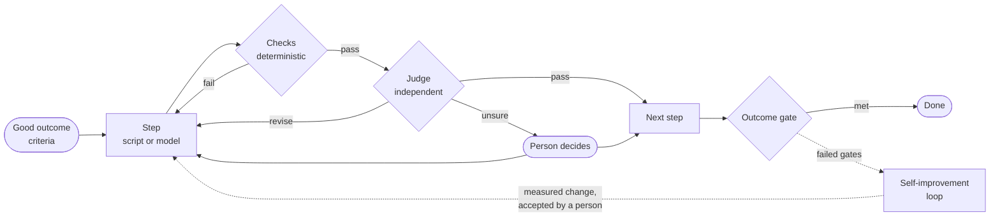

<div align="center">


# tempergraph

**Tempered rails for AI workflows.**

Build AI workflows you can trust: state the good outcome first, check every step against it, and temper the workflow over repeated runs until it holds up without you watching.


[How it works](#how-it-works) · [A workflow](#what-a-workflow-looks-like) · [Getting started](#getting-started) · [CLI](#the-cli) · [Design docs](plugins/tempergraph/docs/README.md) · [Roadmap](#roadmap)

</div>

> [!IMPORTANT]
> **Release 1 is built and offline-tested; it has not yet been run against a live Claude Code session.** The offline suite runs every component on stand-in executors. The checks that need a signed-in `claude` (install from the plugin, a real two-step run, judge scoring, the monitor mod) are listed with their commands and pass criteria in [live-checks.plan.md](plugins/tempergraph/docs/plans/live-checks.plan.md) and are still pending. Expect rough edges until those pass.

## Why tempergraph

Chaining model calls is easy. Trusting the result is not. Most AI workflows check their own work with the same model that did it, retry until something looks plausible, and leave no record of what the run cost or how often a person had to step in.

tempergraph is an opinionated Python engine on [LangGraph](https://github.com/langchain-ai/langgraph) that builds the practices of careful AI engineering into the framework, so people who are not AI-engineering experts still end up with workflows that behave well:

- **Outcome first.** Every workflow states what a good result is, as criteria that a check, a judge or a person verifies. Anything unverified is shown as unverified.
- **Rules before models.** Deterministic checks run first. An independent judge, which cannot see the step's reasoning or edit its work, covers what rules cannot express. The verdict comes from a rule, not from a model's mood.
- **Verdicts drive the graph.** Retries, trips back to an earlier step and pauses for a person are graph edges, each with a budget.
- **People decide pauses.** An agent can relay a person's decision but never makes one, and one command lists everything waiting on a person.
- **Nothing is free by accident.** Every model call is costed (unmeasured is never counted as zero), every run leaves a detailed log, and each run reports how much supervision it needed.
- **Tempered over time.** A self-improvement loop files de-duplicated issues from failed gates, drafts changes, measures them in paired trials and hands them to a person to accept.

## How it works



A **workflow** is declarative data: steps, gates and flow. The engine validates it, compiles it to a durable LangGraph state graph and runs each step as a fresh headless session on an **executor**. Runs survive restarts and can wait days at a pause. A workflow starts in `dev` mode on your machine and moves to a pipeline once its runs show it no longer needs babysitting.

Why "temper": steel is tempered by heating and cooling it in repeated, controlled cycles until it is hard and not brittle. The logo's stripes are the oxide colours steel turns as it is tempered: straw, bronze, purple and blue.

## What a workflow looks like

A workflow is a Claude Code plugin with a Python part. Its plugin name ends in `-tgraph`, for example `release-notes-tgraph`. The good outcome lives in `outcome.json`:

```json
{
  "statement": "Release notes that cover every merged change since the last tag, faithfully.",
  "final": [{
    "id": "rn-complete", "severity": "blocker", "verified_by": "judge",
    "text": "Every merged change since the last tag is in the notes or listed as excluded with a reason"
  }],
  "intermediate": {"draft": {"criteria": [
    {"id": "rn-sections", "verified_by": "check", "text": "The notes have the template's four headings in order"},
    {"id": "rn-faithful", "verified_by": "judge", "text": "Every entry matches what its merged change did"}
  ]}}
}
```

The steps and their gates are declared in Python:

```python
from tempergraph.api import Gate, Judge, Routing, Step, Workflow, text

from .checks import draft_check


def workflow():
    return Workflow(
        order=["draft"],
        routing=Routing(description="Write release notes for the changes since the last tag"),
        units={
            "draft": Step(
                prompt=text("prompts/draft.md"),
                tools=["read", "write"],
                produces={"notes": "file"},
                gate=Gate(check=draft_check, judge=Judge(file="judges/draft.md", references=["notes"])),
            )
        },
    )
```

Both are trimmed from the engine's test fixtures. You don't have to write them by hand: the `author` skill interviews you, starting from the good outcome, and the engine scaffolds, checks and registers the package.

## Getting started

tempergraph needs macOS or Linux, Python 3.11 or newer, git, and [Claude Code](https://docs.claude.com/en/docs/claude-code) signed in. Release 1 runs steps on Claude Code only.

### As a Claude Code plugin

> [!NOTE]
> This is the intended install path. It is live check L-16 and has not been confirmed yet.

```sh
git clone https://github.com/dbr0vskyi/tempergraph.git
claude plugin marketplace add ./tempergraph
claude plugin install tempergraph@tempergraph
```

Then ask Claude to "install tempergraph". The `install` skill shows one plan (the Python it found, where the engine goes, and an optional `PATH` change), asks once, installs, and probes that `claude` is ready. After that, the plugin's skills take over:

| Skill | Use it to |
|---|---|
| `author` | Turn a process, script, template or idea into a workflow, starting from the good outcome |
| `run` | Start, resume and report runs; every pause goes back to you |
| `bootstrap` | Prepare the current repository for tempergraph runs |
| `troubleshoot` | Work out why a run failed or stalled |

The optional `tempergraph-monitor` plugin is a Claude Code mod that shows live runs, alerts, a drill-down per step and cost, inside Claude Code.

### From source

```sh
cd plugins/tempergraph/engine
python -m pip install -e '.[dev]'
python -m pytest           # offline, stand-in executors only
ruff check src tests
mypy
```

Live checks against a signed-in `claude` are marked `live` and run only with `TEMPERGRAPH_LIVE=1`; see [live-checks.plan.md](plugins/tempergraph/docs/plans/live-checks.plan.md).

## The CLI

Every verb is model-free unless it says otherwise, and most print JSON for skills and scripts to read. A few to start with:

| Command | What it does |
|---|---|
| `tempergraph list` | The workflow catalog |
| `tempergraph graph <workflow>` | Draw the workflow |
| `tempergraph run <workflow> --check …` | Preflight a run without spending anything |
| `tempergraph run <workflow> …` | Start a run |
| `tempergraph attention` | Everything waiting on a person, oldest first |
| `tempergraph resume <workflow> <thread> --decision <word>` | Continue a paused run with a person's decision |
| `tempergraph status` · `events` · `logs` | What a run did, step by step |
| `tempergraph report` · `supervision` | Cost, friction and supervision across runs |
| `tempergraph audit <workflow>` | An advisory review of a workflow |
| `tempergraph outcome show <workflow>` | The good outcome and how runs measure against it |
| `tempergraph improve …` · `evals …` · `labels …` | The self-improvement loop, judge calibration and labels |

`tempergraph --help` lists the rest.

## Repository layout

This repository is also a Claude Code plugin marketplace named `tempergraph`.

| Path | What is there |
|---|---|
| [`plugins/tempergraph/`](plugins/tempergraph) | The engine plugin: launcher, skills, hooks and the Python engine in `engine/` |
| [`plugins/tempergraph/docs/`](plugins/tempergraph/docs/README.md) | The engine's design: overview and component specs, decision records, research and plans |
| [`plugins/tempergraph-monitor/`](plugins/tempergraph-monitor) | The monitor mod and its own design docs |
| [`plugins/temperspec-tgraph/`](plugins/temperspec-tgraph/README.md) | temperspec, the delivery workflow built on tempergraph: a task goes through triage, discovery, a plan and tested code to a draft pull request. |
| [`assets/`](assets) | The logo and the social preview image |

The project is designed spec-first: acceptance criteria rank above specs and decision records, which rank above plans, which rank above code. A code change that makes a doc false updates the doc in the same pull request.

## Roadmap

**Release 1** (built, live checks pending): simple trusted workflows on one machine, workflow authoring, full local observability and supervision, and the self-improvement loop, on the Claude Code executor ([scope](plugins/tempergraph/docs/adr/0090-first-release-is-simple-trusted-workflows-on-one-machine.adr.md), [plan](plugins/tempergraph/docs/plans/first-release.plan.md)).

**Designed, not built yet:**

- More executors: the Antigravity CLI, the Claude Agent SDK and the Anthropic Messages API, with refusal before spend when an executor can't enforce what a workflow asks.
- Orchestration: many runs planned as a graph of runs and supervised without a model.
- Advanced node types: councils, contests, per-item maps and the rest of LangGraph's shapes as workflow data.
- Scheduled runs, and engine updates and workflow upgrades that never break a run in flight.
- temperspec as the first large workflow built on the engine.

## License

Proprietary. All rights reserved.
