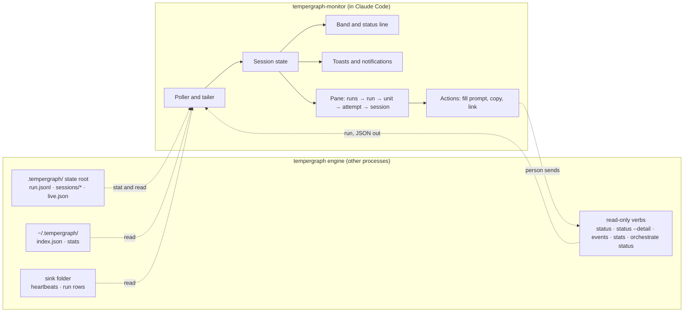

# tempergraph-monitor overview

## 1. Overview

`tempergraph-monitor` is a Claude Code mod (a plugin with a hooks module, [R-001](../research/R-001-claude-code-mods.rsrch.md)) that shows every tempergraph run a person cares about, live, beside the conversation. It borrows the interaction model of Claude Code's dynamic workflows view: a run list, a progress tree you drill into with the arrow keys, narrator lines above the tree, per-agent detail with recent tool calls ([R-002](../research/R-002-dynamic-workflows-view.rsrch.md)). It adds what a workflow view does not have: the declared graph with loop-backs, the four nodes of every unit (step, check, judge, gate), judge criteria and confidence, budgets, reported against estimated cost, pauses waiting for a person, the full session log of every agent on every executor, the shell command a step is running now and the processes under it, and runs on other repositories and machines.

The monitor is an **observer**: it reads engine documents and runs read-only engine verbs; it never starts, resumes, stops or answers a run itself. Every action it offers fills the prompt box with the exact command, and the person sends it ([MADR-0003](../adr/0003-actions-fill-the-prompt.adr.md)).

### Goals

| # | Goal | Where |
|---|---|---|
| MG1 | See every live run of this repository, this machine and, with a sink, the team, without asking | [MBA](02-band-status-and-alerts.spec.md), [MRV](03-run-view.spec.md), [MCF](06-cost-and-fleet.spec.md) |
| MG2 | Enter a run and go down to one attempt's step, check, judge and gate, and to one live session | [MRV](03-run-view.spec.md), [MDD](04-drill-down.spec.md) |
| MG3 | Know what a session is doing now: open tool, shell command, elapsed, child processes | [MDD](04-drill-down.spec.md) |
| MG4 | Never miss a pause: a person is told when a gate waits, wherever they are | [MBA](02-band-status-and-alerts.spec.md) |
| MG5 | See spend as it happens, honestly: reported and estimated apart, incomplete flagged, cap and burn | [MCF](06-cost-and-fleet.spec.md) |
| MG6 | Act without leaving the view, with the person always the one who sends | [MAC](05-actions-and-safety.spec.md) |
| MG7 | Never change, slow or reach into a run, and never be reachable from a headless session | [MDS](01-data-sources.spec.md), [MAC](05-actions-and-safety.spec.md) |

### Non-goals

- Not a run driver: starting runs and answering pauses stay with the engine plugin's run driver skill ([SHL](../../../tempergraph/docs/specs/19-plugin-shell.spec.md)) and the person.
- Not a backend dashboard: long-range analytics belong in `stats` and `report` or in an OTLP backend ([TEL](../../../tempergraph/docs/specs/35-telemetry-export.spec.md)).
- No drill-down into a run on another machine: its logs stay on that machine; the fleet view shows its numbers only.
- No view of a run that is not tempergraph's (a plain dynamic workflow has Claude Code's own view).

## 2. Contract

### 2.1 Layers

| Layer | Holds | Depends on |
|---|---|---|
| Sources | Poller, file tailer, verb caller, cache ([MDS](01-data-sources.spec.md)) | Engine files and read-only verbs; `$.fs`, `$.process`, `$.clock` |
| Model | Session state: runs, open run, selection, filters, alerts already raised | `$.state`, `$.store` |
| Views | Band, status line, toasts and notifications, the pane and its levels | `ui.render` on `AbovePrompt` and `Pane`, `$.ui.*` |
| Actions | Prompt fills, copies, links ([MAC](05-actions-and-safety.spec.md)) | `$.prompt.fill`, `$.ui.copy` |

### 2.2 Spec index

| Prefix | Spec | Owns |
|---|---|---|
| MOV | [00 Overview](00-overview.spec.md) | This index, goals, layers |
| MDS | [01 Data sources](01-data-sources.spec.md) | What the mod reads, how often, and the read-only rule |
| MBA | [02 Band, status line and alerts](02-band-status-and-alerts.spec.md) | The always-on surfaces and when a person is told |
| MRV | [03 Run list and run view](03-run-view.spec.md) | The pane, the run list, the graph view, the orchestration view, keys |
| MDD | [04 Drill-down](04-drill-down.spec.md) | Unit, attempt, check, judge, gate and live session views |
| MAC | [05 Actions and safety](05-actions-and-safety.spec.md) | Every action, the model-tool rule, settings |
| MCF | [06 Cost and fleet](06-cost-and-fleet.spec.md) | Cost tab and the cross-machine view |

### 2.3 Monitor-wide contracts

| # | Contract | Owner |
|---|---|---|
| M1 | The mod never writes under a state root or the engine's home folder, and calls only read-only engine verbs. | [MDS](01-data-sources.spec.md) |
| M2 | Every action that would change a run is a prompt fill the person sends; the mod sends nothing. | [MAC](05-actions-and-safety.spec.md) |
| M3 | The mod offers no tool to any headless session or subagent. | [MAC](05-actions-and-safety.spec.md) |
| M4 | A figure the engine marks unmeasured, estimated or incomplete is shown so; never as 0 or as reported. | [MCF](06-cost-and-fleet.spec.md) |
| M5 | One tree per view for every surface the mod draws on; a surface that lacks an element gets a plainer form, never a blank. | [MRV](03-run-view.spec.md) |

## 3. Behaviours

**MOV-B1 From the band to a shell command.** Given a live run in this repository, when the person opens the pane from the band row, presses Enter on the run, on the running unit, on its attempt and on its step session, then the session view shows the open tool `Bash` with its command summary and elapsed time, the last ten calls and the processes in the session's process group; each level took one key press and no level waited on a model.

| Level | Shows | Source |
|---|---|---|
| Runs | Rows per run, grouped by repository | status, index |
| Run | Units in graph order with S·C·J·G marks | detail |
| Unit | Visits and attempts | detail |
| Attempt | Step, check, judge, gate | detail, evidence |
| Session | Open tool, recent calls, processes, log tail | live file, activity journal, `ps` |

**MOV-B2 A pause reaches the person.** Given a run that pauses at a human gate while the person works in another window, when the pause is read, then a native notification names the run, the gate and the question, and the band row shows the wait time until it is answered.

## 4. Error conditions

| Condition | Result |
|---|---|
| Engine not installed (shim exits 127) | Band row "tempergraph not found", pane explains the installer skill; nothing else polled |
| Engine documents of a newer major schema | Those rows read "update the monitor"; others draw |
| Claude Code build without a needed API | The mod's hook fails alone and Claude Code skips it; the rest draws ([R-001](../research/R-001-claude-code-mods.rsrch.md)) |

## 5. Design notes

- A mod, not a separate app or web page: the person already lives in Claude Code, and a pane beside the chat is where Claude Code shows its own workflow runs ([MADR-0001](../adr/0001-a-claude-code-mod-that-observes.adr.md)).
- The engine owns every document; the monitor parses no executor stream and computes no verdict ([engine ADR-0022](../../../tempergraph/docs/adr/0022-observers-read-files-not-sockets.adr.md)).
- The engine documents the monitor needs and did not exist before are listed in [engine R-021](../../../tempergraph/docs/research/R-021-observer-needs-against-engine-documents.rsrch.md).

## 6. Acceptance criteria

- [ ] MOV-AC-1 Every goal MG1–MG7 is owned by at least one spec and every contract M1–M5 by exactly one.
- [ ] MOV-AC-2 Every spec follows the engine's six-section layout and budget.
- [ ] MOV-AC-3 Every link resolves, including links into the engine set.

## Open questions

| Question | Owner |
|---|---|
| Should the monitor also show plain Claude Code dynamic workflows in the same pane? Out of scope today; Claude Code has its own view. Default for release 1: no. | Owner |

## References

[Docs rules](../../../tempergraph/docs/README.md) · [Decision records](../adr/README.md) · [Research](../research/README.md) · [engine overview](../../../tempergraph/docs/specs/00-overview.spec.md)
