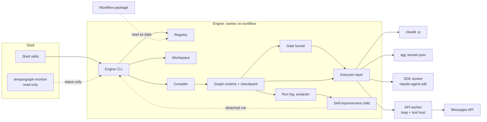

# tempergraph system overview

## 1. Overview

tempergraph ("tempered rails for AI workflows") is an opinionated Python framework on LangGraph. A team's repeated process is written as a **workflow**: declarative data of steps, gates and flow. The engine validates it, compiles it into a durable state graph and runs it. Every step is a fresh headless agent session; after every step a **gate** runs a deterministic check and then an **independent judge** in a fresh read-only session; the **engine**, never the judge, derives the verdict and routes: proceed, retry, go back, ask a person, or stop. Every model call is costed, every run is recorded, and a built-in self-improvement workflow reads finished runs and files issues where the fault lives.

The engine starts sessions through **executors**. Four ship: the **Claude Code CLI** and the **Antigravity CLI** ([ADR-0007](../adr/0007-two-first-class-executors.adr.md)), the **Claude Agent SDK** and Anthropic's **Messages API** ([ADR-0018](../adr/0018-add-messages-api-and-agent-sdk-executors.adr.md)). A workflow names engine-neutral model aliases and tool capabilities, so the same workflow can run its steps on any executor that declares what the step needs, and its judges on whichever executor can enforce a read-only view.

This spec is the index of the set. It holds no component requirement; each requirement lives in exactly one component spec.

### Goals

| # | Goal | Where |
|---|---|---|
| G1 | Start from a stated good outcome: every step declares criteria a judge grades and checks the engine runs. | [WFM](02-workflow-model.spec.md), [JDG](05-judge-and-verdict.spec.md) |
| G2 | Deterministic checks first, an independent judge second, a verdict by rule. | [JDG](05-judge-and-verdict.spec.md), [GRD](06-independence-guard.spec.md) |
| G3 | Retries, trips back and pauses are graph edges driven by verdicts, each bounded by a budget. | [CMP](03-compiler-and-flow.spec.md), [BUD](08-budgets-and-failures.spec.md), [HUM](07-gate-and-human.spec.md) |
| G4 | Durable, resumable runs that survive days at a pause. | [DUR](09-durability-and-resume.spec.md) |
| G5 | The same workflow on the Claude Code CLI, the Antigravity CLI, the Claude Agent SDK or the Messages API, with refusal before spend when an executor cannot enforce what is asked. | [EXI](10-executor-interface.spec.md), [ECC](11-executor-claude-code.spec.md), [EAG](12-executor-antigravity.spec.md), [EAS](21-executor-agent-sdk.spec.md), [EMA](20-executor-messages-api.spec.md) |
| G6 | Every model call costed; unmeasured is never zero. | [OBS](15-observability-and-cost.spec.md) |
| G7 | A closed improvement loop that files scrubbed, de-duplicated issues, drafts measured changes and hands them to a person. | [SIL](16-self-improvement.spec.md), [PRP](40-improvement-proposals.spec.md), [FBK](41-feedback-and-judge-reliability.spec.md), [LSN](42-workflow-lessons.spec.md), [IMD](43-improvement-data.spec.md) |
| G8 | Non-experts author good workflows through a guided skill and enforced validation. | [SHL](19-plugin-shell.spec.md), [WFM](02-workflow-model.spec.md) |
| G9 | Many runs planned as a graph of runs, validated before spend and supervised without a model, with every pause left to a person. | [ORC](45-orchestration.spec.md), [OSK](46-orchestrator-skill.spec.md) |

### Non-goals

- Not a replacement for pull-request review; a finalizer opens a draft at most.
- Not deterministic output: the graph, budgets and escalation paths are fixed, model output is not.
- Not a production-workload orchestrator: non-production work on synthetic or test data.
- Not a general chat agent: a good candidate is repeated, has known inputs and ends in something a check or a judge can grade.
- No executor beyond the four in the first release. The interface admits more (a hosted service, another model family's SDK) without an engine edit.
- Not a general tool harness: the engine's own tool host serves only the Messages API executor and only the ten capability names ([THS](22-tool-host.spec.md)).

## 2. Contract

### 2.1 Layers and dependency direction

| Layer | Name | Holds | Depends on |
|---|---|---|---|
| 1 | Engine | Registry, compiler, graph runtime, gate funnel, executors, tool host, checkpoint, run log, analyzer, workspace, the built-in self-improvement workflow | LangGraph, SQLite, the two CLIs as child processes, the Agent SDK and the Anthropic client library inside engine worker processes |
| 2 | Workflows as data | One package per workflow: spec, checks, prompts, start facts, eval scenarios | The engine's public interface only |
| 3 | Authoring surface | Agents, skills and rules a workflow's prompts invoke inside a step session, per executor | The workflow |
| 4 | Shell | Skills that drive the engine CLI from a conversation, the orchestrator skill among them; the read-only monitor (separate plugin) | The engine CLI, the status document and the orchestration status document |

### 2.2 Spec index

| Prefix | Spec | Owns |
|---|---|---|
| OVR | [00 Overview](00-overview.spec.md) | This index, goals, layers, engine-wide contracts |
| CON | [01 Contracts](01-contracts.spec.md) | Every shared type |
| WFM | [02 Workflow model and validation](02-workflow-model.spec.md) | What a workflow declares; what is refused before a run |
| CMP | [03 Compiler and flow](03-compiler-and-flow.spec.md) | Four nodes per unit, edges, flow primitives |
| PRM | [04 Prompt rendering and output contract](04-prompt-rendering.spec.md) | What a step is told and must emit |
| JDG | [05 Judge and verdict](05-judge-and-verdict.spec.md) | Judge session, judgement block, verdict derivation |
| GRD | [06 Independence guard and judge views](06-independence-guard.spec.md) | View sets, the catalog, the after-the-fact guard |
| HUM | [07 Gate and human nodes](07-gate-and-human.spec.md) | Routing, pauses, approvals, event waits, decisions |
| BUD | [08 Budgets, failures and timeouts](08-budgets-and-failures.spec.md) | Counters, failure causes, loop-backs, limits |
| DUR | [09 Durability and resume](09-durability-and-resume.spec.md) | Checkpoints, thread states, resume, status, wait |
| EXI | [10 Executor interface](10-executor-interface.spec.md) | Protocol, capabilities, preflight, binding, lifetime, conformance |
| ECC | [11 Claude Code executor](11-executor-claude-code.spec.md) | `claude -p` mapping |
| EAG | [12 Antigravity executor](12-executor-antigravity.spec.md) | `agy` mapping |
| EMA | [20 Messages API executor](20-executor-messages-api.spec.md) | Engine-owned loop on the Messages API |
| EAS | [21 Claude Agent SDK executor](21-executor-agent-sdk.spec.md) | `claude-agent-sdk` mapping |
| THS | [22 Tool host](22-tool-host.spec.md) | The engine's client tools for the Messages API |
| WSP | [13 Workspace and concurrency](13-workspace-and-concurrency.spec.md) | State root, worktrees, writers, batches |
| SEC | [14 Security posture](14-security.spec.md) | Launch rules, scrubbing, publish boundary |
| OBS | [15 Observability and cost](15-observability-and-cost.spec.md) | Run log, live progress, cost, reports |
| SIL | [16 Self-improvement loop](16-self-improvement.spec.md) | Lenses, filing, calibration feedback |
| CLI | [17 Engine CLI](17-engine-cli.spec.md) | Verbs, options, catalog |
| LIF | [18 Lifecycle and evals](18-lifecycle-and-evals.spec.md) | Install, update, compatibility, diagrams, evals |
| SHL | [19 Plugin shell](19-plugin-shell.spec.md) | The skills the engine plugin ships |
| PRP | [40 Improvement proposals and trials](40-improvement-proposals.spec.md) | Clusters, proposals, change classes, case sets, trials |
| FBK | [41 Feedback labels and judge reliability](41-feedback-and-judge-reliability.spec.md) | Labels, reliability grades, labelling queue, binding-shift watch |
| LSN | [42 Workflow lessons](42-workflow-lessons.spec.md) | Per-step lessons files and how they render and change |
| IMD | [43 Improvement data requirements](43-improvement-data.spec.md) | The loop's requirements on the shared run store |
| ORC | [45 Orchestration of runs](45-orchestration.spec.md) | Orchestration file, supervisor, node states, `orchestrate` verbs, orchestration status document |
| OSK | [46 Orchestrator skill](46-orchestrator-skill.spec.md) | The skill that plans, starts and walks a person through an orchestration |
| JCL | [50 Judge calibration and acceptance](50-judge-calibration.spec.md) | Gold case sets, judge scores and figures, the acceptance bar and state |
| EVS | [51 Eval suites for checks, steps and workflows](51-eval-suites.spec.md) | Suite kinds and roles, grader order, live-suite caps, corrected judge-graded rates |

### 2.3 Engine-wide contracts

| # | Contract | Owner |
|---|---|---|
| C1 | Every model call is an executor run, logged with its usage. Finalizers and routes call no model. | [OBS](15-observability-and-cost.spec.md) |
| C2 | Logging, reports and self-improvement are best effort and never change a run or its exit code. | [OBS](15-observability-and-cost.spec.md) |
| C3 | Executors behave the same everywhere: one renderer, prompt off argv, constants-only argv, no raise, children tied to the engine. | [EXI](10-executor-interface.spec.md) |
| C4 | A step never grades itself; an independent judge assesses; the engine derives the verdict. | [JDG](05-judge-and-verdict.spec.md) |
| C5 | Gates, routes and joins are pure and safe to re-run; the judge and the gate run once. | [CMP](03-compiler-and-flow.spec.md) |
| C6 | One interrupt per gate; only a person decides a pause. | [HUM](07-gate-and-human.spec.md) |
| C7 | State is JSON merged by reducers under a stable thread id; a fresh run never merges into a thread. | [DUR](09-durability-and-resume.spec.md) |
| C8 | The engine core never names a workflow. | [WFM](02-workflow-model.spec.md) |
| C9 | Secrets are scrubbed; published artefacts carry metadata only. | [SEC](14-security.spec.md) |
| C10 | Paths resolve inside the workspace; the state root is the main checkout. | [WSP](13-workspace-and-concurrency.spec.md) |
| C11 | One graph per process. | [WSP](13-workspace-and-concurrency.spec.md) |
| C12 | Versioned schemas, tolerant readers. | [CON](01-contracts.spec.md) |
| C13 | Input resolution and the read-only verbs call no model and create nothing. | [CLI](17-engine-cli.spec.md) |
| C14 | A measurement call never writes code. | [SIL](16-self-improvement.spec.md) |
| C15 | A capability an executor does not declare is a refusal before spend, never a silent downgrade. | [EXI](10-executor-interface.spec.md) |
| C16 | The orchestration supervisor calls no model and answers no gate; it starts, resumes and stops runs only through the engine's own verbs. | [ORC](45-orchestration.spec.md) |

## 3. Behaviours

**OVR-B1 A run end to end.** Given a registered workflow and a request, when an operator starts a run, then the engine resolves the input (read-only), preflights every executor, alias and tool, classifies the thread, takes the lock, prepares the workspace, compiles the graph and drives its units; each unit runs its step session, its check, its judge session and its gate; a pause exits 3; the last gate is followed by the finalizer and the recording, and the run exits with a code from [CON §2.9](01-contracts.spec.md).

| Stage | Owner spec | Spends model calls |
|---|---|---|
| Resolve input | [CLI](17-engine-cli.spec.md) | no |
| Preflight | [EXI](10-executor-interface.spec.md) | no |
| Thread check, lock, workspace | [DUR](09-durability-and-resume.spec.md), [WSP](13-workspace-and-concurrency.spec.md) | no |
| Compile | [CMP](03-compiler-and-flow.spec.md) | no |
| Step, check, judge, gate | [PRM](04-prompt-rendering.spec.md), [JDG](05-judge-and-verdict.spec.md), [HUM](07-gate-and-human.spec.md) | yes (step, judge) |
| Finalizer, recording | [OBS](15-observability-and-cost.spec.md) | no |
| Self-improvement child | [SIL](16-self-improvement.spec.md) | yes, detached |

**OVR-B2 Mixed executors.** Given a workflow whose steps run on Antigravity and whose executor cannot restrict judge tools, when the run is preflighted, then each such step's judge is bound to an executor that declares `restricts_judge_tools`, or the start is refused with exit 2 ([ADR-0013](../adr/0013-cross-executor-judging.adr.md)).

## 4. Error conditions

| Condition | Result |
|---|---|
| A spec names a requirement another spec owns | Review finding; the duplicate row is removed |
| A component needs a type not in [CON](01-contracts.spec.md) | The type is added to CON first |

## 5. Design notes

- **Ecosystem for mechanism, bespoke for policy.** The graph, checkpointer and interrupt come from LangGraph ([ADR-0002](../adr/0002-langgraph-graph-runtime.adr.md)); the gate funnel, executors, registry and input resolution are tempergraph's own.
- **Assumptions** made because the owner was unavailable are recorded in [ADR-0001](../adr/0001-standalone-design-assumptions.adr.md).
- The `tempergraph-monitor` plugin is a separate design set; this set fixes only the status document it reads ([DUR](09-durability-and-resume.spec.md)).

## 6. Acceptance criteria

- [ ] OVR-AC-1 Every goal G1–G9 is owned by at least one component spec, and every contract C1–C16 by exactly one.
- [ ] OVR-AC-2 Every spec in the index exists, follows the six-section layout and stays within 400 lines and 30 KB.
- [ ] OVR-AC-3 Every link between specs, decision records and research notes resolves.
- [ ] OVR-AC-4 No component spec defines a type that [CON](01-contracts.spec.md) also defines.

## Open questions

| Question | Owner |
|---|---|
| Is account-based (consumer) Antigravity use permitted as a child process for the operator's account type? | Owner ([R-002](../research/R-002-antigravity-cli-headless.rsrch.md)) |
| May the Agent SDK executor run on an operator's subscription sign-in, or only on API and cloud credentials? The design assumes the latter. | Owner ([R-005](../research/R-005-claude-agent-sdk-executor.rsrch.md)) |

## References

