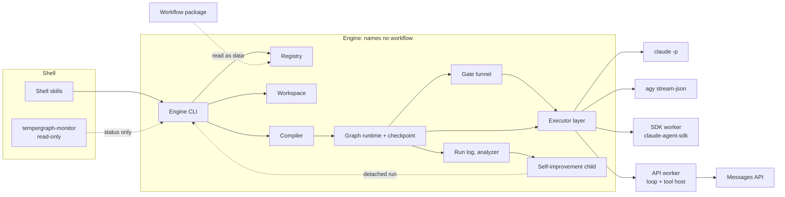

# tempergraph system overview

## 1. Overview

tempergraph ("tempered rails for AI workflows") is an opinionated Python framework on LangGraph. A team's repeated process is written as a **workflow**: declarative data of steps, gates and flow. The engine validates it, compiles it into a durable state graph and runs it. Every step is a fresh headless agent session; after every step a **gate** runs a deterministic check and then an **independent judge** in a fresh read-only session; the **engine**, never the judge, derives the verdict and routes: proceed, retry, go back, ask a person, or stop. Every model call is costed, every run is recorded, and a built-in self-improvement workflow reads finished runs and files issues where the fault lives.

The engine starts sessions through **executors**. Four are designed, and release 1 ships the first of them, `claude` ([ADR-0091](../adr/0091-first-release-ships-the-claude-executor-only.adr.md)): the **Claude Code CLI** and the **Antigravity CLI** ([ADR-0007](../adr/0007-two-first-class-executors.adr.md)), the **Claude Agent SDK** and Anthropic's **Messages API** ([ADR-0018](../adr/0018-add-messages-api-and-agent-sdk-executors.adr.md)). A workflow names engine-neutral model aliases and tool capabilities, so the same workflow can run its steps on any executor that declares what the step needs, and its judges on whichever executor can enforce a read-only view.

This spec is the index of the set. It holds no component requirement; each requirement lives in exactly one component spec.

### Goals

| # | Goal | Where |
|---|---|---|
| G1 | Start from a stated good outcome: a run-level outcome with final and intermediate criteria, each verified by a check, a judge or a person or shown as unverified, graded at every step gate and at a final outcome gate. | [OUT](90-run-outcome.spec.md), [WFM](02-workflow-model.spec.md), [JDG](05-judge-and-verdict.spec.md) |
| G2 | Deterministic checks first, an independent judge second, a verdict by rule. | [JDG](05-judge-and-verdict.spec.md), [GRD](06-independence-guard.spec.md) |
| G3 | Retries, trips back and pauses are graph edges driven by verdicts, each bounded by a budget. | [CMP](03-compiler-and-flow.spec.md), [BUD](08-budgets-and-failures.spec.md), [HUM](07-gate-and-human.spec.md), [RST](80-run-settings-and-overrides.spec.md) |
| G4 | Durable, resumable runs that survive days at a pause, and reruns from any unit with a person's feedback. | [DUR](09-durability-and-resume.spec.md), [RRN](81-reruns-and-feedback.spec.md) |
| G5 | The same workflow on the Claude Code CLI, the Antigravity CLI, the Claude Agent SDK or the Messages API, with refusal before spend when an executor cannot enforce what is asked. | [EXI](10-executor-interface.spec.md), [ECC](11-executor-claude-code.spec.md), [EAG](12-executor-antigravity.spec.md), [EAS](21-executor-agent-sdk.spec.md), [EMA](20-executor-messages-api.spec.md) |
| G6 | Every model call costed; unmeasured is never zero. | [OBS](15-observability-and-cost.spec.md) |
| G7 | A closed improvement loop that files scrubbed, de-duplicated issues, drafts measured changes and hands them to a person. | [SIL](16-self-improvement.spec.md), [PRP](40-improvement-proposals.spec.md), [FBK](41-feedback-and-judge-reliability.spec.md), [LSN](42-workflow-lessons.spec.md), [IMD](43-improvement-data.spec.md), [SRV](44-session-review.spec.md) |
| G8 | Non-experts author good workflows from an existing solution, references or a conversation, through a guided skill that works backwards from the good outcome, a scaffold that writes a Claude plugin with a Python part and its own docs, and checks up to a first trial. | [AUT](89-workflow-authoring.spec.md), [SCF](91-blueprint-and-scaffold.spec.md), [PKG](88-workflow-package.spec.md), [SHL](19-plugin-shell.spec.md), [WFM](02-workflow-model.spec.md), [AUD](55-workflow-audit.spec.md) |
| G9 | Many runs planned as a graph of runs, validated before spend and supervised without a model, with every pause left to a person. | [ORC](45-orchestration.spec.md), [OSK](46-orchestrator-skill.spec.md) |
| G10 | The engine and each workflow move between releases without losing a run: an update that never breaks work in flight, and a workflow upgrade planned by data, edited by rule or a gated model, and verified before it is stamped. | [UPD](60-engine-update.spec.md), [VER](61-version-metadata.spec.md), [MIG](62-state-and-run-migration.spec.md), [WUP](63-workflow-upgrade.spec.md), [UWF](64-upgrade-workflow.spec.md), [LSK](65-lifecycle-skills.spec.md) |
| G11 | Every graph shape LangGraph can build, except the self-routing forms [R-060](../research/R-060-node-types-against-langgraph.rsrch.md) excludes, is declarable as workflow data, and higher-level units (scripts, councils, contests, asks) keep every outcome engine-derived and judged. | [SCR](70-script-units-and-hybrid-steps.spec.md), [CNL](71-council-unit.spec.md), [CTS](72-contest-unit.spec.md), [ASK](73-ask-unit.spec.md), [FLX](74-flow-extensions.spec.md) |
| G12 | A delivery workflow such as temperspec is expressible through the public interface alone: checks that run commands and record facts, step values, per-item maps, measured switches and a finalizer that can never fail a passed run. | [CHK](75-check-contract-and-command-runs.spec.md), [VAL](76-step-values-and-template-keys.spec.md), [MAP](77-map-unit.spec.md), [FIN](78-finalizer-contract.spec.md), [SWM](79-measured-switches.spec.md) |
| G13 | Every call and intervention on a run is attributed to a person, an agent (relaying a person or on its own), the orchestrator, a pipeline or the engine, and every run reports how much supervision it needed and what supervising it cost, so a workflow is promoted on needing less of both. | [PRV](85-caller-provenance.spec.md), [SUP](86-supervision-metrics.spec.md), [SCO](87-supervision-cost.spec.md) |
| G14 | A person or a script schedules a workflow or an orchestration once or on a recurrence, in an exact date format or optionally in plain words, both model-free, confirms the exact form the engine echoes back, and the run fires on any OS with no terminal open, capped, attested as scheduled and still answered by a person at every pause. | [SCH](83-schedules.spec.md), [TCK](84-schedule-ticks-and-unattended-fires.spec.md) |

### Non-goals

- Not a replacement for pull-request review; a finalizer opens a draft at most.
- Not deterministic output: the graph, budgets and escalation paths are fixed, model output is not.
- Not a production-workload orchestrator: non-production work on synthetic or test data.
- Not a general chat agent: a good candidate is repeated, has known inputs and ends in something a check or a judge can grade.
- No executor beyond the four. Releases 1 and 2 ship `claude` only; what each release holds is [ADR-0090](../adr/0090-first-release-is-simple-trusted-workflows-on-one-machine.adr.md). The interface admits more (a hosted service, another model family's SDK) without an engine edit.
- Not a general tool harness: the engine's own tool host serves only the Messages API executor and only the ten capability names ([THS](22-tool-host.spec.md)).

## 2. Contract

### 2.1 Layers and dependency direction

| Layer | Name | Holds | Depends on |
|---|---|---|---|
| 1 | Engine | Registry, compiler, graph runtime, gate funnel, executors, tool host, checkpoint, run log, analyzer, workspace, the built-in self-improvement workflow | LangGraph, SQLite, the two CLIs as child processes, the Agent SDK and the Anthropic client library inside engine worker processes |
| 2 | Workflows as data | One package per workflow: spec, checks, prompts, start facts, eval scenarios | The engine's public interface only |
| 3 | Authoring surface | Agents, skills and rules a workflow's prompts invoke inside a step session, per executor | The workflow |
| 4 | Shell | Skills that drive the engine CLI from a conversation, the orchestrator skill among them; the read-only monitor (separate plugin) | The engine CLI, the status document and the orchestration status document |

### 2.2 Spec index

| Prefix | Spec | Owns |
|---|---|---|
| OVR | [00 Overview](00-overview.spec.md) | This index, goals, layers, engine-wide contracts |
| CON | [01 Contracts](01-contracts.spec.md) | Every shared type |
| WFM | [02 Workflow model and validation](02-workflow-model.spec.md) | What a workflow declares; what is refused before a run |
| CMP | [03 Compiler and flow](03-compiler-and-flow.spec.md) | Four nodes per unit, edges, flow primitives |
| PRM | [04 Prompt rendering and output contract](04-prompt-rendering.spec.md) | What a step is told and must emit |
| JDG | [05 Judge and verdict](05-judge-and-verdict.spec.md) | Judge session, judgement block, verdict derivation |
| GRD | [06 Independence guard and judge views](06-independence-guard.spec.md) | View sets, the catalog, the after-the-fact guard |
| HUM | [07 Gate and human nodes](07-gate-and-human.spec.md) | Routing, pauses, approvals, event waits, decisions |
| BUD | [08 Budgets, failures and timeouts](08-budgets-and-failures.spec.md) | Counters, failure causes, loop-backs, limits |
| DUR | [09 Durability and resume](09-durability-and-resume.spec.md) | Checkpoints, thread states, resume, status, wait |
| EXI | [10 Executor interface](10-executor-interface.spec.md) | Protocol, capabilities, preflight, binding, lifetime, conformance |
| ECC | [11 Claude Code executor](11-executor-claude-code.spec.md) | `claude -p` mapping |
| EAG | [12 Antigravity executor](12-executor-antigravity.spec.md) | `agy` mapping |
| EMA | [20 Messages API executor](20-executor-messages-api.spec.md) | Engine-owned loop on the Messages API |
| EAS | [21 Claude Agent SDK executor](21-executor-agent-sdk.spec.md) | `claude-agent-sdk` mapping |
| THS | [22 Tool host](22-tool-host.spec.md) | The engine's client tools for the Messages API |
| WSP | [13 Workspace and concurrency](13-workspace-and-concurrency.spec.md) | State root, shapes of parallel work, writers, batches; the worktree itself is [WTR](82-worktree-mode.spec.md) |
| SEC | [14 Security posture](14-security.spec.md) | Launch rules, scrubbing, publish boundary |
| OBS | [15 Observability and cost](15-observability-and-cost.spec.md) | Run log, live progress, cost, reports |
| SIL | [16 Self-improvement loop](16-self-improvement.spec.md) | Lenses, filing, calibration feedback |
| CLI | [17 Engine CLI](17-engine-cli.spec.md) | Verbs, options, catalog |
| LIF | [18 Lifecycle and evals](18-lifecycle-and-evals.spec.md) | Install, update, compatibility, diagrams, evals |
| SHL | [19 Plugin shell](19-plugin-shell.spec.md) | The skills the engine plugin ships |
| EVT | [30 Run events for observers](30-run-events.spec.md) | Record envelope, observer record kinds, activity journal, `events`, observer interface, hook events |
| RDD | [31 Run detail document](31-run-detail-document.spec.md) | One thread in full, for the monitor and people |
| RCT | [32 Run control](32-run-control.spec.md) | The `stop` verb |
| LOS | [33 Local observability store](33-local-observability-store.spec.md) | State-root and home layouts, session and engine logs, retention |
| CST | [34 Central run stats](34-central-run-stats.spec.md) | Machine index, sinks, cross-machine stats |
| TEL | [35 Telemetry export](35-telemetry-export.spec.md) | OTLP export with the GenAI conventions; deferred, not in the first release ([ADR-0029](../adr/0029-own-observability-first-export-deferred.adr.md)) |
| PRP | [40 Improvement proposals and trials](40-improvement-proposals.spec.md) | Clusters, proposals, change classes, case sets, trials |
| FBK | [41 Feedback labels and judge reliability](41-feedback-and-judge-reliability.spec.md) | Labels, reliability grades, labelling queue, binding-shift watch |
| LSN | [42 Workflow lessons](42-workflow-lessons.spec.md) | Per-step lessons files and how they render and change |
| IMD | [43 Improvement data requirements](43-improvement-data.spec.md) | The loop's requirements on the shared run store |
| SRV | [44 Session digest and session review](44-session-review.spec.md) | Model-free digest of every session; review plans by mode and signal; the tool-less reviewer and its checked observations |
| ORC | [45 Orchestration of runs](45-orchestration.spec.md) | Orchestration file, supervisor, node states, `orchestrate` verbs, orchestration status document |
| OSK | [46 Orchestrator skill](46-orchestrator-skill.spec.md) | The skill that plans, starts and walks a person through an orchestration |
| JCL | [50 Judge calibration and acceptance](50-judge-calibration.spec.md) | Gold case sets, judge scores and figures, the acceptance bar and state |
| EVS | [51 Eval suites for checks, steps and workflows](51-eval-suites.spec.md) | Suite kinds and roles, grader order, live-suite caps, corrected judge-graded rates |
| AUD | [55 Workflow audit](55-workflow-audit.spec.md) | The `audit` verb, its layers, report, views and ignores |
| ARC | [56 Audit rule catalog](56-audit-rule-catalog.spec.md) | The audit's rules outside tools, keyed to ranked causes |
| TSA | [57 Tool surface audit](57-tool-surface-audit.spec.md) | Grant, need and use of each step and judge session; the tool rules |
| PRA | [58 Prompt audit](58-prompt-audit.spec.md) | Model-facing text: names resolved and current, agreement with declarations, size |
| UPD | [60 Engine install and update](60-engine-update.spec.md) | The `install` and `update` verbs: side-by-side engine environments, shim, extras, rollback, plugin and engine in step, the workflow registry and its reinstall and pins |
| VER | [61 Version metadata](61-version-metadata.spec.md) | Engine release record, typed changelog, transforms, workflow version fields, stamp record, change notes, compatibility states |
| MIG | [62 State and run migration](62-state-and-run-migration.spec.md) | Store layout migration, running and paused threads across releases, pins, workflow change under a thread |
| WUP | [63 Workflow upgrade](63-workflow-upgrade.spec.md) | The `upgrade` verb: baseline, plan, transforms, assist, verification, stamp, report |
| UWF | [64 Built-in upgrade workflow](64-upgrade-workflow.spec.md) | The gated workflow that makes the model-assisted edits and drafts the owner's answers |
| LSK | [65 Lifecycle skills](65-lifecycle-skills.spec.md) | The install, update and upgrade skills: one plan, one yes, then the plugin commands and the verbs |
| SCR | [70 Script units and hybrid steps](70-script-units-and-hybrid-steps.spec.md) | Model-free script units, `before` and `after` scripts on a step, the script result cache |
| CNL | [71 Council unit](71-council-unit.spec.md) | Members, modes, rounds, anonymity, the engine tally, no-decision pauses |
| CTS | [72 Contest unit](72-contest-unit.spec.md) | Candidate slots, per-candidate judging, the pick rule, retry scope |
| ASK | [73 Ask unit](73-ask-unit.spec.md) | Questions, typed answers, the `input` pause, the answers artifact |
| FLX | [74 Flow extensions](74-flow-extensions.spec.md) | Selective parallel, mapped sub-workflows, deadlines, fallback target, operator breakpoints |
| CHK | [75 Check contract and command runs](75-check-contract-and-command-runs.spec.md) | What a check receives and returns, findings, facts, the command runner, the check worker, the check preview |
| VAL | [76 Step values and template keys](76-step-values-and-template-keys.spec.md) | The `value` artifact kind; engine, item and artifact keys a template may name |
| MAP | [77 Map unit](77-map-unit.spec.md) | Map declaration, fan-out, per-item gates and budgets, the join |
| FIN | [78 Finalizer contract](78-finalizer-contract.spec.md) | Finalizer context, commands, outcomes, once-only and exit-code rule |
| SWM | [79 Measured switches](79-measured-switches.spec.md) | Shadow mode, per-arm overrides, re-arming |
| RST | [80 Run settings and overrides](80-run-settings-and-overrides.spec.md) | The settings catalog, scopes, layers and their order, settings files, workflow settings and profiles, snapshot on resume, the effective-settings record, the `config` verb |
| RRN | [81 Reruns, rewinds and feedback](81-reruns-and-feedback.spec.md) | Every way to run again, feedback at every resume, rulings, `rewind`, the `rerun` verb |
| WTR | [82 Worktree mode](82-worktree-mode.spec.md) | The `run.workspace` parameter and its `auto` rule, worktree roots, bases and names, lifecycle on pause, resume, rerun and finish, cleanup, executor pointing, foreign worktrees, the `worktree` verb |
| SCH | [83 Schedules](83-schedules.spec.md) | The When grammar and its echo, zones and daylight saving, the schedule entry and fire log, catch-up, overlap, failure and spend policies, the `schedule` verbs |
| TCK | [84 Schedule ticks and unattended fires](84-schedule-ticks-and-unattended-fires.spec.md) | The OS-agnostic tick and its triggers (portable loop by default; OS, host and external schedulers as adapters), the fire token, the machine-wide scheduled-run ledger and the other records a fire leaves, unattended credentials per executor, pipeline export, the schedule skill |
| PRV | [85 Caller provenance](85-caller-provenance.spec.md) | Caller kinds, signals and their order, deciders and relay evidence, the `caller` block, host profiles |
| SUP | [86 Supervision metrics](86-supervision-metrics.spec.md) | Touches and their classes, the per-run supervision record and level, workflow aggregates, where they land, supervision criteria for promotion |
| SCO | [87 Supervision cost](87-supervision-cost.spec.md) | The supervision journal, usage sources per host, attribution of a supervising session's spend, closing, the `supervision` verbs |
| PKG | [88 Workflow package](88-workflow-package.spec.md) | Layout of the plugin, Python and docs halves, the engine manifest, declaration builders and callable signatures, loading, what reaches each executor, the minimal package |
| AUT | [89 Workflow authoring](89-workflow-authoring.spec.md) | Entry paths, intake inventory, the backwards interview, verification search and classification, authoring record, revise mode |
| OUT | [90 Run-level good outcome](90-run-outcome.spec.md) | The outcome file, verifier classes, trust and coverage, the outcome gate, the outcome record and measures, revisions |
| SCF | [91 Blueprint, scaffold and authoring checks](91-blueprint-and-scaffold.spec.md) | The blueprint and its drawing, the literal check, the scaffold and its generated tests, `author verify` up to a first trial |
| LAD | [92 Effort ladder and one-step model escalation](92-effort-ladder-and-model-escalation.spec.md) | Evidence, escalation |
| JRK | [93 Judge model by risk](93-judge-model-by-risk.spec.md) | Risk levels, floor |
| CXR | [94 Complexity routing between decompositions](94-complexity-routing.spec.md) | Zones, re-arm |
| PRO | [95 Promotion check and workflow stages](95-promotion-check.spec.md) | Stages, stamp |
| CAR | [96 Run state carried on a branch](96-run-state-on-a-branch.spec.md) | State branch |
| WIN | [97 Windows support](97-windows-support.spec.md) | Platform rules |

### 2.3 Engine-wide contracts

| # | Contract | Owner |
|---|---|---|
| C1 | Every model call is an executor run, logged with its usage. Finalizers and routes call no model. | [OBS](15-observability-and-cost.spec.md) |
| C2 | Logging, reports and self-improvement are best effort and never change a run or its exit code. | [OBS](15-observability-and-cost.spec.md) |
| C3 | Executors behave the same everywhere: one renderer, prompt off argv, constants-only argv, no raise, children tied to the engine. | [EXI](10-executor-interface.spec.md) |
| C4 | A step never grades itself; an independent judge assesses; the engine derives the verdict. | [JDG](05-judge-and-verdict.spec.md) |
| C5 | Gates, routes and joins are pure and safe to re-run; the judge and the gate run once. | [CMP](03-compiler-and-flow.spec.md) |
| C6 | One interrupt per gate; only a person decides a pause. | [HUM](07-gate-and-human.spec.md) |
| C7 | State is JSON merged by reducers under a stable thread id; a fresh run never merges into a thread. | [DUR](09-durability-and-resume.spec.md) |
| C8 | The engine core never names a workflow. A workflow's request for an engine change lands only as a capability any workflow can use ([ADR-0129](../adr/0129-the-engine-names-no-workflow-and-takes-requests-as-general-capabilities.adr.md)). | [WFM](02-workflow-model.spec.md) |
| C9 | Secrets are scrubbed; published artefacts carry metadata only. | [SEC](14-security.spec.md) |
| C10 | Paths resolve inside the workspace; the state root is the main checkout. | [WSP](13-workspace-and-concurrency.spec.md) |
| C11 | One graph per process. | [WSP](13-workspace-and-concurrency.spec.md) |
| C12 | Versioned schemas, tolerant readers. | [CON](01-contracts.spec.md) |
| C13 | Input resolution and the read-only verbs call no model and create nothing. | [CLI](17-engine-cli.spec.md) |
| C14 | A measurement call never writes code. | [SIL](16-self-improvement.spec.md) |
| C15 | A capability an executor does not declare is a refusal before spend, never a silent downgrade. | [EXI](10-executor-interface.spec.md) |
| C16 | The orchestration supervisor calls no model and answers no gate; it starts, resumes and stops runs only through the engine's own verbs. | [ORC](45-orchestration.spec.md) |
| C17 | Every intervention on a run carries its caller and decider with the evidence for them; a person is never inferred from a caller's word alone. | [PRV](85-caller-provenance.spec.md) |
| C18 | The schedule tick calls no model and answers no gate; it starts runs and orchestrations only through the engine's own verbs, and a slot starts at most once. | [TCK](84-schedule-ticks-and-unattended-fires.spec.md) |

## 3. Behaviours

**OVR-B1 A run end to end.** Given a registered workflow and a request, when an operator starts a run, then the engine resolves the input (read-only), preflights every executor, alias and tool, classifies the thread, takes the lock, prepares the workspace, compiles the graph and drives its units; each unit runs its step session, its check, its judge session and its gate; a pause exits 3; the last gate is followed by the finalizer and the recording, and the run exits with a code from [CON §2.9](01-contracts.spec.md).

| Stage | Owner spec | Spends model calls |
|---|---|---|
| Resolve input | [CLI](17-engine-cli.spec.md) | no |
| Preflight | [EXI](10-executor-interface.spec.md) | no |
| Thread check, lock, workspace | [DUR](09-durability-and-resume.spec.md), [WSP](13-workspace-and-concurrency.spec.md) | no |
| Compile | [CMP](03-compiler-and-flow.spec.md) | no |
| Step, check, judge, gate | [PRM](04-prompt-rendering.spec.md), [JDG](05-judge-and-verdict.spec.md), [HUM](07-gate-and-human.spec.md) | yes (step, judge) |
| Finalizer, recording | [OBS](15-observability-and-cost.spec.md) | no |
| Self-improvement child | [SIL](16-self-improvement.spec.md) | yes, detached |

**OVR-B2 Mixed executors.** Given a workflow whose steps run on Antigravity and whose executor cannot restrict judge tools, when the run is preflighted, then each such step's judge is bound to an executor that declares `restricts_judge_tools`, or the start is refused with exit 2 ([ADR-0013](../adr/0013-cross-executor-judging.adr.md)).

## 4. Error conditions

| Condition | Result |
|---|---|
| A spec names a requirement another spec owns | Review finding; the duplicate row is removed |
| A component needs a type not in [CON](01-contracts.spec.md) | The type is added to CON first |

## 5. Design notes

- **Ecosystem for mechanism, bespoke for policy.** The graph, checkpointer and interrupt come from LangGraph ([ADR-0002](../adr/0002-langgraph-graph-runtime.adr.md)); the gate funnel, executors, registry and input resolution are tempergraph's own.
- **Assumptions** made because the owner was unavailable are recorded in [ADR-0001](../adr/0001-standalone-design-assumptions.adr.md).
- The `tempergraph-monitor` plugin is a separate design set ([plugins/tempergraph-monitor/docs](../../../tempergraph-monitor/docs/specs/00-overview.spec.md)); this set fixes the documents it reads: the status document ([DUR](09-durability-and-resume.spec.md)), the detail document ([RDD](31-run-detail-document.spec.md)) and the observer events ([EVT](30-run-events.spec.md)). Specs 30 to 35 hold the observability design asked for on 2026-11-19 ([R-021](../research/R-021-observer-needs-against-engine-documents.rsrch.md)).

## 6. Acceptance criteria

- [ ] OVR-AC-1 Every goal G1–G14 is owned by at least one component spec, and every contract C1–C18 by exactly one.
- [ ] OVR-AC-2 Every spec in the index exists, follows the six-section layout and stays within 400 lines and 30 KB.
- [ ] OVR-AC-3 Every link between specs, decision records and research notes resolves.
- [ ] OVR-AC-4 No component spec defines a type that [CON](01-contracts.spec.md) also defines.

## Open questions

| Question | Owner |
|---|---|
| Is account-based (consumer) Antigravity use permitted as a child process for the operator's account type? | Owner ([R-002](../research/R-002-antigravity-cli-headless.rsrch.md)) |
| May the Agent SDK executor run on an operator's subscription sign-in, or only on API and cloud credentials? The design assumes the latter. | Owner ([R-005](../research/R-005-claude-agent-sdk-executor.rsrch.md)) |

## References

