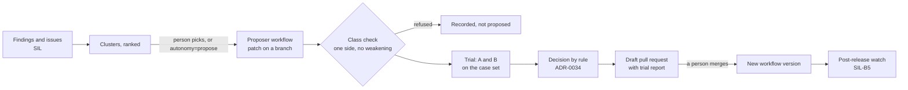

# Improvement proposals and trials

## 1. Overview

The second half of the self-improvement loop. [SIL](16-self-improvement.spec.md) turns runs into findings and issues; this spec turns a cluster of findings into a **proposal** (a typed, small change to one workflow package), measures it in a **trial** (the current and the proposed version on the same fixed cases), and hands the result to a person as a draft pull request. The loop never merges, never changes engine code and never changes a step together with the gate that grades it ([ADR-0030](../adr/0030-improvement-closes-through-measured-proposals.adr.md), [ADR-0031](../adr/0031-steps-and-their-graders-change-apart.adr.md)). The background is [R-030](../research/R-030-self-improving-agent-systems.rsrch.md) and [R-031](../research/R-031-self-improvement-gap-analysis.rsrch.md).

## 2. Contract

### 2.1 Autonomy level

Declared per workflow as `improvement.autonomy`, overridable down (never up) per machine.

| Level | The loop may | Default |
|---|---|---|
| `record` | Write findings, evidence and ledger rows only | |
| `file` | Also file and comment on issues ([SIL](16-self-improvement.spec.md)) | yes |
| `propose` | Also run the proposer on a cluster and open a draft pull request without a trial | |
| `trial` | Also run trials, under the workflow's `improvement.trial_cap_usd` per trial and a monthly cap | |

There is no level that merges. A person can start the proposer or a trial on any workflow at any level with the verbs in §2.7.

### 2.2 Clusters and the ranked backlog

| Field | Meaning |
|---|---|
| `cluster_id` | Digest of side, workflow, unit and leading cause, or of unit and criterion id for judge-sent-back retries |
| `findings[]`, `issues[]` | Members, by id |
| `runs`, `distinct_requests`, `machines` | Counts, from the shared store when present, else the local ledger ([IMD](43-improvement-data.spec.md)) |
| `repeat_cost_usd` | Estimated cost of repeats whose recorded cause is in the cluster, 30-day window |
| `label_weight` | Count of negative human labels joined to the cluster's gates ([FBK](41-feedback-and-judge-reliability.spec.md)) |
| `score` | `repeat_cost_usd + label_value × label_weight`, then ordered; `label_value` defaults to $5 |
| `twin_of` | A cluster on the other side (engine or workflow) with the same unit and cause |

A cluster with `twin_of` set is shown once, under the side the friction judge attributed first; the twin is linked, not listed again.

### 2.3 Proposal

| Field | Kind | Meaning |
|---|---|---|
| `proposal_id` | id | |
| `workflow`, `base_version`, `base_digest` | | The package the patch applies to |
| `cluster_id` | id | The problem it answers; one cluster per proposal |
| `author` | `person` \| `proposer` | Who wrote the patch |
| `patch` | unified diff over the workflow package | Never a path outside the package |
| `classes[]` | set of §2.4 classes | Computed by the engine from the patch, never taken from the author |
| `side` | `producer` \| `grader` | From the classes |
| `rule` | one sentence | The general rule the change states; no id, URL, number or quote |
| `state` | `drafted`, `refused`, `trialling`, `shown_better`, `not_shown`, `regressed`, `aborted`, `opened`, `merged`, `closed` | |
| `refusal` | reason code, when refused | |

### 2.4 Change classes

The engine classifies a patch by comparing the parsed workflow before and after, not by reading the diff text.

| Class | Side | What changed |
|---|---|---|
| `prompt` | producer | A step's template text or tools block |
| `lessons` | producer | Entries of a step's lessons ([LSN](42-workflow-lessons.spec.md)) |
| `limits` | producer | A step's timeout, retry budget or idle limit |
| `model` | producer | A step's alias or executor |
| `tools` | producer | A step's declared tools, MCP tools, skills or command prefixes. A widening `tools` patch drafted from `grant_missing` findings declares exactly the grants people gave and used, names the runs they came from, and is always opened for a person's review, never trialled alone ([ADR-0080](../adr/0080-a-person-may-grant-a-step-tools-for-a-run.adr.md)); a judge view widened from `views.add` grants is class `weakening` |
| `flow` | producer | A route arm, a split of one step into passes, a new unit |
| `brief` | grader | A judge brief or stance |
| `criterion` | grader | Criterion text, a new criterion, a criterion's method |
| `check` | grader | A deterministic check's code or its declared commands |
| `judge_model` | grader | A judge's alias or executor |
| `outcome` | grader | The outcome file: statement, final or intermediate criteria, `serves`, a verifier moved up the ladder with its evidence ([OUT §2.6](90-run-outcome.spec.md)); from release 3 |
| `weakening` | grader | A criterion removed; a severity lowered from blocker; a verifier moved down the ladder of [OUT §2.6](90-run-outcome.spec.md); a check that passes on a fixture where it failed before; a judge view set widened; a budget raised above 2× |

### 2.5 Case set

Each workflow package may hold a case set: `schema_version` and one entry per case.

| Field | Meaning |
|---|---|
| `case_id` | Stable id |
| `base` | A commit of the target repository, or a fixture folder in the package |
| `request` | The start input, scrubbed |
| `expected_scope` | One line a person wrote |
| `origin` | `authored` or `harvested:<run id>` |
| `reviewed_by` | A person; harvested cases without it are not used |

A case harvested from a run that is a member of the proposal's cluster is **in-sample** for that proposal.

### 2.6 Trial

| Field | Meaning |
|---|---|
| `trial_id`, `proposal_id`, `case_set_digest` | |
| `arms` | `A` (base version) and `B` (patched version), each run as a dry-run batch child per case, in its own worktree at the case's base ([WSP](13-workspace-and-concurrency.spec.md)) |
| `target_metric` | One of `first_pass_yield(unit)`, `gate_pass(unit)`, `criterion_met(unit, id)`, `run_cost`, `outcome_met`, `label_agreement(gate)` |
| `guards[]` | Metrics that must not worsen beyond a margin: by default run cost +15%, outcome met −1 case, any deterministic check pass rate −1 case, gate escapes +1 |
| `pairs[]` | Per case: A value, B value, `win` \| `loss` \| `tie`, in-sample flag |
| `noise_floor` | Share of differing pairs in the case set's last A/A run, or `unknown` |
| `decision` | Per [ADR-0034](../adr/0034-paired-trial-on-a-fixed-case-set.adr.md): `shown_better`, `not_shown`, `regressed`, `aborted` |
| `spend` | Reported and estimated cost of both arms, apart ([OBS](15-observability-and-cost.spec.md)) |

Decision rule, on out-of-sample non-tied pairs only: `shown_better` when wins reach the one-sided sign-test p ≤ 0.05 count of [R-031 F3](../research/R-031-self-improvement-gap-analysis.rsrch.md) and every guard holds; `regressed` when losses reach that count or any guard fails; otherwise `not_shown`. Fewer than 8 out-of-sample non-tied pairs is `not_shown` with reason `too_few_pairs`. A noise floor above 0.5 adds the warning `noisy_case_set`.

A trial whose target metric is a judge grade (`gate_pass`, `criterion_met`, `outcome_met`) needs that judge graded `reliable` by [FBK](41-feedback-and-judge-reliability.spec.md); otherwise the trial is refused before spend.

### 2.7 Verbs

| Verb | Does | Writes | Spends |
|---|---|---|---|
| `improve backlog [workflow]` | Clusters, ranked, with twins folded | no | no |
| `improve propose <cluster> [--patch <file>]` | Runs the proposer workflow, or records a person's patch, then classifies | branch, proposal record | proposer only |
| `improve trial <proposal> [--cases <set>] [--cap <usd>]` | Runs both arms and decides | trial record, batch folders | yes |
| `improve aa <workflow> [--cases <set>]` | Runs the case set twice on the current version and records the noise floor | trial record | yes |
| `improve open <proposal>` | Opens the draft pull request with the trial report | pull request | no |
| `improve show <proposal\|trial>` | One record, read-only | no | no |

## 3. Behaviours

**PRP-B1 One side only.** Given a proposer patch that edits a step's template and the same step's criterion text, when it is classified, then the classes are `prompt` and `criterion`, the sides differ, and the proposal is `refused` with `mixed_sides`; nothing is trialled.

**PRP-B2 Weakening is person-only.** Given a patch that lowers a criterion from blocker to warning, when classified, then `weakening` is set. From `author=proposer` it is `refused` with `weakening`. From `author=person` it is kept, can be trialled only on grader metrics, and the pull request is labelled `weakens-gate` with the before and after severity.

| Author | Classes | Result |
|---|---|---|
| proposer | `prompt` | drafted |
| proposer | `prompt`, `lessons` | drafted (one side) |
| proposer | `prompt`, `check` | refused `mixed_sides` |
| proposer | `criterion`, `weakening` | refused `weakening` |
| person | `criterion`, `weakening` | drafted, labelled |

**PRP-B3 No request literals.** Given a patch that adds a ticket id, a URL or a run's request words to a prompt or lesson, when classified, then the literals check of prompt lint ([LIF](18-lifecycle-and-evals.spec.md)) fails and the proposal is `refused` with `literal`.

**PRP-B4 Proposer is gated like any workflow.** Given the proposer workflow, when it runs, then its patch step works in its own worktree on a branch `improve/<proposal_id>`, its check applies the patch, validates the workflow and runs the class check, and an independent judge grades whether the change addresses the cluster's cause and states a general rule; it never writes outside the workflow package and never pushes the default branch.

**PRP-B5 Grader proposals are scored on labels.** Given a proposal of side `grader` (say a sharper criterion text), when trialled, then the arms are the judge alone on the gate's calibration cases and labelled past attempts ([LIF](18-lifecycle-and-evals.spec.md) live scoring), the target metric is `label_agreement(gate)`, and no step session runs.

**PRP-B6 Trial on paired cases.** Given 14 out-of-sample cases with target `first_pass_yield(plan)`, when the trial ends with 9 wins, 1 loss and 4 ties and every guard holds, then 10 pairs are non-tied, 9 wins meets the p ≤ 0.05 count for 10, and the decision is `shown_better`.

| Wins | Losses | Ties | Guards | Decision |
|---|---|---|---|---|
| 9 | 1 | 4 | hold | `shown_better` |
| 7 | 3 | 4 | hold | `not_shown` |
| 9 | 1 | 4 | cost +22% | `regressed` |
| 4 | 1 | 9 | hold | `not_shown` (`too_few_pairs`) |

**PRP-B7 Cap stops a trial cleanly.** Given a trial cap of $200, when both arms' estimated spend reaches it, then no further case starts, running children finish, the decision is `aborted` and the pairs so far are kept.

**PRP-B8 Draft pull request, never a merge.** Given a proposal `shown_better` on a workflow at autonomy `trial`, when the trial ends, then a draft pull request is opened against the workflow's repository with the trial report (pairs as counts, metrics, spend, noise floor, classes, the rule sentence), linked to the cluster's issues; nothing is merged, and the issues stay open until a person merges.

**PRP-B9 Measured after release.** Given a merged proposal, when the first 10 final exits of the new version are recorded, then the post-release comparison of SIL-B5 runs on the trial's target and guards; a guard worse than its margin reopens the issues and records `regressed_after_release` on the proposal.

**PRP-B10 Engine side stays an issue.** Given a cluster on side `engine` or `executor:<name>`, when `improve propose` is asked for it, then it is refused with `engine_side`; the loop drafts no engine code.

## 4. Error conditions

| Condition | Result |
|---|---|
| Patch does not apply to `base_digest` | `refused` `stale_base`; the proposer may rerun on the new version |
| Patched workflow fails validation | `refused` `invalid` with the validation output |
| No case set, or none reviewed | Trial refused before spend, exit 2 |
| Judge-graded target with an unreliable judge | Trial refused before spend, exit 2 |
| Monthly trial cap reached | Trial refused before spend, exit 2; the backlog shows it |
| Code host unreachable at `open` | Proposal stays `shown_better`; `open` can be rerun |

## 5. Design notes

- The proposer is reflective in the sense of [R-030 F3](../research/R-030-self-improving-agent-systems.rsrch.md): it reads the cluster's cause codes, per-criterion statuses and fixes, and the local evidence of its member runs, and proposes one small delta. A search over many candidates is not in the first release; a later one may keep several drafts per cluster and trial the best two.
- The engine classifies from the parsed workflow, so a proposer cannot hide a weakening in a reformatted file.
- C14 still holds: trials and the post-release comparison write no code; only the proposer writes, and only workflow data on its own branch.
- Defaults (label value $5, guard margins, the monthly cap, 10 runs after release) have no data behind them and are recorded as parameters with that provenance ([IMD](43-improvement-data.spec.md)).

## 6. Acceptance criteria

- [ ] PRP-AC-1 Every row of the PRP-B2 table is reproduced by the classifier on fixture patches, including a weakening hidden in a reordered file.
- [ ] PRP-AC-2 No code path merges a pull request or pushes a default branch; a source test fails if one calls a merge.
- [ ] PRP-AC-3 Every row of the PRP-B6 table is reproduced by the decision function.
- [ ] PRP-AC-4 A trial on a judge-graded target with an unreliable judge spends nothing.
- [ ] PRP-AC-5 In-sample pairs are reported and never counted in the decision.
- [ ] PRP-AC-6 A trial's spend is logged per session like any run and joined to no workflow run's own cost line.

## Open questions

| Question | Owner |
|---|---|
| Should `propose` become the default autonomy once the first workflow has a reviewed case set? Assumed no: `file` stays the default until the owner decides. | Owner |

## References

[SIL](16-self-improvement.spec.md) · [FBK](41-feedback-and-judge-reliability.spec.md) · [LSN](42-workflow-lessons.spec.md) · [IMD](43-improvement-data.spec.md) · [LIF](18-lifecycle-and-evals.spec.md) · [WSP](13-workspace-and-concurrency.spec.md) · [R-030](../research/R-030-self-improving-agent-systems.rsrch.md) · [R-031](../research/R-031-self-improvement-gap-analysis.rsrch.md)
