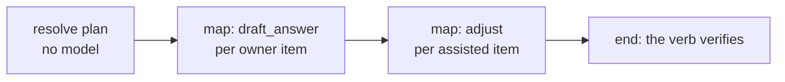

# Built-in upgrade workflow

## 1. Overview

The model-assisted part of a workflow upgrade ([WUP §2.5](63-workflow-upgrade.spec.md)) is itself a tempergraph workflow, shipped with the engine like the self-improvement workflow ([SIL](16-self-improvement.spec.md)). It takes the items of one upgrade plan that no transform can do, edits the workflow package on the upgrade branch, and is held to the engine's own rails: every edit is a step session followed by a deterministic check and an independent judge, the engine derives the verdict, budgets bound retries, and every question only the owner can answer is a pause for the owner ([ADR-0058](../adr/0058-upgrade-by-transforms-first-and-a-gated-model-workflow-for-the-rest.adr.md)).

It never verifies the whole upgrade, never stamps and never opens a pull request; those stay with the model-free verb ([WUP §2.6](63-workflow-upgrade.spec.md)).

## 2. Contract

### 2.1 Registration and input

| Rule | Value |
|---|---|
| Found by | A flag on its spec (`builtin: upgrade`), not by its name; registered after every package so none can shadow it ([WFM](02-workflow-model.spec.md)) |
| Started by | `upgrade` only, with `origin: upgrade` ([DUR §2.2](09-durability-and-resume.spec.md)); a direct `run` is refused with exit 2 |
| Input | `upgrade_id`; a model-free input resolver reads `plan.json` and `baseline.json` ([WUP §2.2](63-workflow-upgrade.spec.md)) and produces two list artifacts, `owner_items` and `assisted_items` |
| Workspace | The upgrade branch's worktree; edits limited to the package folder |
| Executor and models | `UpgradePolicy.executor` ([VER §2.4](61-version-metadata.spec.md)), default `claude`; step model `large`, judge model `medium`; overridable by the verb's `--executor` |
| Cost | Run cost cap from the verb's `--cap`, default $10 ([BUD](08-budgets-and-failures.spec.md)) |

### 2.2 Units

| Unit | Kind | Per | Does | Gate |
|---|---|---|---|---|
| `draft_answer` | map, sequential | owner item | Reads the entry and the package and drafts the smallest change that would answer the owner's question, with the question, the choices, and what each choice would change; writes the draft change on the branch | §2.4 check and judge, then `approval: true`: the owner proceeds (the draft is the answer), retries with feedback (a new draft), or stops (the item is skipped, with the feedback as reason) |
| `adjust` | map, sequential | assisted item | Makes the edit the entry's instruction asks for at each hit | §2.4 check and judge; no approval |

Owner items run first because an owner's answer can change what an assisted edit must do. Both maps are sequential, so edits on one branch never race ([CMP](03-compiler-and-flow.spec.md)).

### 2.3 What a step is told and may use

| Part | Content |
|---|---|
| Template | The entry's `note`, its `assisted` instruction or `owner` question ([VER §2.3.3](61-version-metadata.spec.md)), the item's hits with file and field path, the list of `protected` paths, and the workflow's own criteria text for the units the hits sit in, so the intent of the gate the change touches is in view |
| Subject files | The files the hits name, read through tools, not pasted |
| Tools | `read`, `search`, `list`, `edit`, `write`; `shell` with a command allow-list of the engine's read-only verbs (`validate`, `upgrade --check`, `audit --layer definition`) and the package's own check-fixture command ([EVS](51-eval-suites.spec.md)) |
| Never | Network tools; a path outside the package; editing a `protected` path in `adjust` (such an item was turned into an owner item by the plan, [WUP §2.3](63-workflow-upgrade.spec.md)) |
| Output | The edit on the branch and a short change note per hit: what was changed and why, which the report quotes |

### 2.4 Gate of each item

The check runs first; the judge runs only when it passes ([JDG](05-judge-and-verdict.spec.md)).

| Check (deterministic) | Fails when |
|---|---|
| Scope | The diff of this attempt touches a file outside the package, or, in `adjust`, a `protected` path |
| Proof | The item's detect rules still hit, or a `proof` code of its entry is still raised ([VER §2.3](61-version-metadata.spec.md)) |
| Fixtures | A changed check or resolver fails its must-pass or must-fail fixtures |

| Criterion (judge) | Severity |
|---|---|
| The edit does what the entry's instruction asks at every hit, and nothing that only the owner should decide | blocker |
| Behaviour the entry does not concern is unchanged: no rewording, reformatting or extra edits outside the hits' need | blocker |
| No criterion, check or judge view is weakened, and no rubric or bar is invented ([PRP §2.4](40-improvement-proposals.spec.md) `weakening`) | blocker |
| The diff is the smallest that meets the instruction | warning |

The judge reads the diff, the entry's note and instruction, and the files before the edit, in a read-only view on an executor that declares `restricts_judge_tools` ([GRD](06-independence-guard.spec.md), [ADR-0013](../adr/0013-cross-executor-judging.adr.md)). Retry budget 2 per item; when it is spent, `on_budget_spent: ask` pauses for the person, who may retry with feedback, proceed (the item is left for a hand edit, and the verb's verification will name it), or stop.

## 3. Behaviours

**UWF-B1 An assisted edit is gated.** Given an `adjust` item whose instruction says a check must now read `state.attempts[-1]` instead of `state.last_output`, when the step edits `checks/coverage.py`, then the check re-runs the entry's `symbol` rule and the check's fixtures; only when both pass does the judge grade the edit, and the engine derives the verdict.

**UWF-B2 Out-of-scope edit is retried.** Given an attempt that also reformats an unrelated template, when the judge grades it, then the second blocker is `UNMET`, the verdict is `RETRY`, and the next attempt is told the criterion and the place.

**UWF-B3 The owner's answer is the owner's.** Given an owner item asking for the repository that receives the workflow's issues, when `draft_answer` drafts `issue_repository` from the package's git remote, then the run pauses at the approval with the question, the draft and its effect; the value stays on the branch only if the owner proceeds.

| Owner's decision at the approval | Item state | `by` |
|---|---|---|
| proceed | `answered` | person |
| retry with feedback | `pending`, a new draft | — |
| stop | `skipped`, reason from the feedback | person |

**UWF-B4 A protected path stays the owner's.** Given an assisted entry whose hit is a criterion text (protected by default), when the plan runs, then the item is an owner item, so the model's change to it reaches the branch only through the owner's approval.

**UWF-B5 Direct start refused.** Given `tempergraph run upgrade …` typed by a person, when it is checked, then it exits 2 and names `tempergraph upgrade <workflow>`.

## 4. Error conditions

| Condition | Result |
|---|---|
| `plan.json` missing or of another engine version | Input resolver refuses; exit 2 |
| A step session fails for infrastructure | As any run: exit 5 after its policy; the verb reports items left `pending` |
| The cap is spent | Exit 5; finished items stay on the branch |
| No executor declares `restricts_judge_tools` for the judge | Preflight exit 2, as for any workflow ([EXI](10-executor-interface.spec.md)) |

## 5. Design notes

- Running the model's part as a workflow is the engine's own thesis applied to itself: a model edit is a step, an independent judge grades it, a rule decides ([ADR-0005](../adr/0005-independent-judge-engine-verdict.adr.md)). It also makes the upgrade visible to `status`, the monitor and the cost reports with no new mechanism.
- Steps and their gates change apart ([ADR-0031](../adr/0031-steps-and-their-graders-change-apart.adr.md)): the model may touch a gate's text only through an owner item, so a grader is never loosened by the session it would grade.
- Like every workflow, this one is evaluated: its check and step suites ([EVS](51-eval-suites.spec.md)) hold fixture packages with planted upgrade items, and its judge is calibrated before the workflow is `stable` ([JCL](50-judge-calibration.spec.md)).
- **As built (R2-T6.4).** `builtin/upgrade.py` builds the workflow: a script unit that reads the open items, then one map that drafts an answer for each owner item and one that makes each model item's edit, each graded by the four checks of §2.4 and then the judge. The flag is the spec's `builtin` field, whose value is now `true` (self-improvement) or a name (`upgrade`); a built-in is exempt from the issue-repository rule, is added to the catalog after every package, is hidden from `workflows list`, and `run` refuses it by name. It runs in place inside the upgrade's worktree: an in-place run started inside a linked worktree stays in that worktree ([WTR](82-worktree-mode.spec.md)). Its inputs and results travel in `.tempergraph-upgrade/` under the worktree, which the upgrade removes before it commits.

## 6. Acceptance criteria

- [x] UWF-AC-1 The workflow validates under the engine that ships it and is found by its flag, not its name (source-scan test).
- [x] UWF-AC-2 Each check of §2.4 has a fixture attempt that fails it alone.
- [x] UWF-AC-3 Every row of UWF-B3's table is a test with a scripted executor.
- [x] UWF-AC-4 No attempt of the workflow can write outside the package folder (file-system guard with scripted executors).
- [ ] UWF-AC-5 The workflow's step suite upgrades each planted item of its fixture packages, and its judge's gold set reaches the acceptance bar of [JCL](50-judge-calibration.spec.md) before it is marked `stable`.

## Open questions

| Question | Owner |
|---|---|
| Should items of one entry that hit many files be grouped into one `adjust` item per file, as public practice does per file ([R-056](../research/R-056-automated-and-model-assisted-migrations.rsrch.md) M4), or kept per entry? The design keeps one item per entry and hit set; measure on the first breaking release. | Implementer |

## References

[WUP](63-workflow-upgrade.spec.md) · [VER](61-version-metadata.spec.md) · [JDG](05-judge-and-verdict.spec.md) · [HUM](07-gate-and-human.spec.md) · [SIL](16-self-improvement.spec.md) · [R-056](../research/R-056-automated-and-model-assisted-migrations.rsrch.md)
