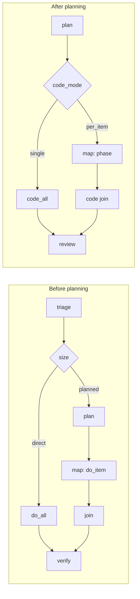

# Complexity routing between decompositions

## 1. Overview

A workflow may do the same job in a simple shape (one step does the whole task) or a detailed shape (a plan step, a map over its items, a join), and choose per run by how complex the task is or by another parameter. temperspec measured why: per-phase code cost 130% of one session on small plans, while long single sessions timed out on large ones ([R-126](../research/R-126-routing-by-complexity-between-decompositions.rsrch.md) F1).

A **complexity switch** is a measured switch ([SWM](79-measured-switches.spec.md)) whose predicate the engine builds from declared **measures** and a **rules file**. It adds five rules: measures are model-free, the most detailed arm is the failsafe and wins the margin, re-arming runs one way and once, every arm honours one **arm contract** for the units after it, and the choice is reported by arm and zone ([ADR-0123](../adr/0123-complexity-chooses-a-decomposition-through-a-measured-switch.adr.md)). No new unit kind is added ([ADR-0062](../adr/0062-new-node-kinds-keep-the-gated-unit.adr.md)).

## 2. Contract

### 2.1 Declaration

| Field (on a `switch` unit, with `complexity`) | Kind | Meaning |
|---|---|---|
| `arms` | ordered list, 2 or 3 | From the simplest to the most detailed. The last arm is the **safe arm** and the switch's `default` |
| `complexity.measures` | list of `{name, from}` | `from` is a stock measure (§2.3) or a callable ref `(ctx: MeasureContext) -> int \| float \| str`, pure and model-free |
| `complexity.rules` | path in the package, default `routing/<switch>.json` | §2.4 |
| `complexity.size` | measure name, optional | The measure that size-adjusts cost in the report (§2.7) |
| `complexity.explore` | `{rate, per_week}`, optional | Margin exploration (§2.6); off when absent |
| `complexity.joins_at` | unit name | The first unit every arm path reaches; the arm contract is checked there (§2.5) |
| `mode`, `arm_overrides`, `sticky` | as SWM and CMP | `sticky` is `run`; a complexity switch is never re-evaluated per visit |
| `rearm` | as SWM §2.4, restricted by §2.5 | Optional |

The `predicate` field is refused on a complexity switch; the engine evaluates the rules. A plain switch with a hand-written predicate stays available for any other choice ([SWM](79-measured-switches.spec.md)).

### 2.2 Shapes

| Shape | Measures known | Example rule |
|---|---|---|
| Before planning | Request size, acceptance criteria counted by the triage check, files or components named, input labels | `direct` when criteria ≤ 3 and named files ≤ 2 |

### 2.3 Measures

`MeasureContext` holds `request`, `facts` (check facts of earlier units on the path), `artifacts` (pointers only), `settings`, `stage` ([PRO §2.1](95-promotion-check.spec.md)), `git` (of the run's workspace at the switch) and `read_text(path)` for files under the workspace. It holds no step `value`: a step's assessment of complexity counts only once a check verified it and recorded it as a fact ([R-126](../research/R-126-routing-by-complexity-between-decompositions.rsrch.md) F2).

| Stock measure | Returns |
|---|---|
| `fact(<unit>, <key>)` | A check fact, as a number when it parses as one |
| `input(<name>)`, `setting(<name>)` | A declared input or a resolved workflow setting |
| `count_items(<unit>, <key>)` | Items a map would read from that artifact, by the map's own extractor ([MAP §2.1](77-map-unit.spec.md)) |
| `count_lines(<unit>, <key>, <pattern>)` | Lines of a file artifact matching a regular expression |
| `changed_paths()` | Paths changed in the workspace since the run's base |

A measure that raises, exceeds 1 s or returns another type is a **fault**.

### 2.4 Rules file and zones

The rules file lists, per arm except the safe arm, the bounds that make the arm eligible, and an optional margin band per measure.

| Field | Meaning |
|---|---|
| `schema_version` | 1 |
| `arms.<arm>.when` | Map measure → `{max}`, `{min}`, `{in: [...]}`; every bound must hold |
| `margin.<measure>` | `{from, to}`: a value inside the band puts the run in the margin |

A repository may override the file at `.tempergraph/routing/<workflow>/<switch>.json`, whole-file; the record names the file and its digest. Evaluation, in order:

| Order | Zone | Arm |
|---|---|---|
| 1 | `fault`: any measure faulted, or the rules file is missing or invalid | Safe arm |
| 2 | `margin`: any measure inside its margin band | Safe arm, unless exploration picks (§2.6) |
| 3 | `simple`: the simplest arm whose every bound holds | That arm |
| 4 | `complex`: no arm's bounds hold | Safe arm |

An operator's `--arm` ([CMP-B7](03-compiler-and-flow.spec.md)) wins over every zone and is recorded `chosen_by: operator`.

### 2.5 Arm contract and one-way re-arm

| Rule | Detail |
|---|---|
| Arm contract | Every artifact key, item-keyed artifact and fact that a unit from `joins_at` on reads must be produced on every arm path; checked at validation from the declared `produces` and checks |
| Same final verification | No arm may hold the final outcome gate, and the gates from `joins_at` on are the same for every arm; an arm changes how the work is done, never what verifies it ([ADR-0071](../adr/0071-overrides-never-change-what-verifies-the-work.adr.md)) |
| Direction | A `rearm` entry must go from an arm to a later arm in `arms` |
| Once | At most one re-arm per run; after it the safe arm's own policy applies |
| Evidence | A re-arm on `budget_spent` happens only when the attempt that spent the budget carried climbing evidence ([LAD §2.2](92-effort-ladder-and-model-escalation.spec.md)); a budget spent on held causes applies the gate's `on_budget_spent`. A re-arm on `timeout` needs a step timeout, not an infra `slow_host` |
| Before a stronger model | While a re-arm is available for a unit, that unit never escalates its model ([LAD §2.4](92-effort-ladder-and-model-escalation.spec.md) E8) |

### 2.6 Exploration

With `explore`, a run in the margin takes a simpler eligible arm when `hash(thread_id, switch) mod 1000 < rate × 1000` and fewer than `per_week` explored runs of the workflow started in the last 7 days. `rate` is at most 0.25 and `per_week` at most 5. Exploration never runs at stage `pipeline`, on a scheduled fire ([TCK](84-schedule-ticks-and-unattended-fires.spec.md)) or in a trial, and an explored run is recorded `zone: explore`.

### 2.7 Records and report

The `route` record ([SWM §2.2](79-measured-switches.spec.md)) gains `zone`, `measures` (name → value or fault), `rules_digest` and `rules_source` (`package` or `repository`). `report --switch <workflow>/<switch>` shows, per arm and zone, for finished runs of one workflow version: runs, first-pass yield of the gates from the switch to `joins_at`, cost per completed run, cost per unit of `size`, wall time, re-arm rate and the outcome verdict mix. Re-armed runs are shown apart and are excluded from the per-arm figures. A cell with fewer than 5 runs is marked `too few to compare` ([R-126](../research/R-126-routing-by-complexity-between-decompositions.rsrch.md) F8).

## 3. Behaviours

**CXR-B1 Zones.** Given arms `[direct, planned]`, measures `criteria` and `files`, rules `direct.when: {criteria: {max: 3}, files: {max: 2}}` and margin `criteria: {from: 4, to: 5}`, when runs reach the switch with these measures, then they take these arms.

| criteria | files | Zone | Arm |
|---|---|---|---|
| 2 | 1 | simple | direct |
| 2 | 4 | complex | planned |
| 4 | 1 | margin | planned |
| fault | 1 | fault | planned |

**CXR-B2 Shadow first.** Given the switch of CXR-B1 with `mode: shadow`, when a run has `criteria: 2, files: 1`, then `planned` runs and the route record holds `would_choose: direct, zone: simple`.

**CXR-B3 One-way re-arm on evidence.** Given `rearm: [{from: direct, to: planned, units: [do_all], on: [budget_spent, timeout]}]`, when `do_all` spends its budget, then the run re-arms only as the table says.

| Last failed attempt of `do_all` | Effect |
|---|---|
| Judge RETRY, `accepted` judge, substantive blocker | Re-arm to `planned`, `chosen_by: rearm` |
| Step timeout | Re-arm to `planned` |
| Turn cap or infra | Gate's `on_budget_spent` |
| Any failure after one re-arm in this run | Gate's `on_budget_spent` |

**CXR-B4 Arm contract.** Given `joins_at: verify`, where `verify` reads artifact `change`, when `planned`'s join produces `change` and `direct`'s `do_all` produces only `patch`, then validation fails with `arm-contract` naming `direct`, `change` and `verify`.

**CXR-B5 Exploration stays out of the pipeline.** Given `explore: {rate: 0.2, per_week: 2}` and a margin run whose hash picks exploration, when the stage is `local-stable` and one explored run started this week, then `direct` runs with `zone: explore`; when the stage is `pipeline`, `planned` runs.

**CXR-B6 Other parameters.** Given a measure `setting(review_depth)` and rules `direct.when: {review_depth: {in: [light]}}`, when a run starts with `--set review_depth=thorough`, then the zone is `complex` and `planned` runs; with `--arm size=direct` as well, `direct` runs with `chosen_by: operator`.

## 4. Error conditions

| Condition | Result |
|---|---|
| `predicate` declared on a complexity switch | Validation error |
| An arm contract key missing on an arm path | Validation error `arm-contract` |
| An arm path that holds the final outcome gate, or different gates from `joins_at` on | Validation error |
| A `rearm` toward a simpler arm | Validation error |
| A rules file naming an undeclared arm or measure | Validation error at load; at run time (a repository override) a `fault` zone |
| `explore.rate` > 0.25 or `per_week` > 5 | Validation error |

## 5. Design notes

- Predict, then fall back once: neither alone suits a mix where most tasks are complex but some are trivial ([R-126](../research/R-126-routing-by-complexity-between-decompositions.rsrch.md) F5).
- Thresholds are data so the improvement loop can move them: a change to a rules file is a producer proposal of kind `flow` ([PRP §2.3](40-improvement-proposals.spec.md)), measured by a trial on the case set; a repository override is the person's own, recorded on every route record.
- A complexity switch inside a map item is refused, as a map in a map is ([MAP §2.3](77-map-unit.spec.md)); per-item choice stays `item_model`.
- Remedy order across specs for one unit: the effort ladder, a re-arm, one model step, a person ([LAD §5](92-effort-ladder-and-model-escalation.spec.md)).

## 6. Acceptance criteria

- [ ] CXR-AC-1 CXR-B1 to CXR-B6 and every table row hold offline with scripted executors.
- [ ] CXR-AC-2 A measure cannot read a step `value`: a fixture whose step writes `ARTIFACT size: trivial` routes the same as one that writes nothing.
- [ ] CXR-AC-3 Every §4 row has a fixture workflow that fails with its finding code.
- [ ] CXR-AC-4 `report --switch` excludes re-armed runs from per-arm figures and marks cells under 5 runs.
- [ ] CXR-AC-5 A run never re-arms twice and never re-arms toward a simpler arm.

## Open questions

| Question | Owner | Default |
|---|---|---|
| Should `route` mode be refused in `local-stable` without a shadow record? | Owner | Warned in `local-stable`; the promotion check needs ≥ 5 runs per used arm for `pipeline` ([PRO §2.3](95-promotion-check.spec.md)) |
| Should the report suggest new thresholds? | Owner | No: figures only, as SWM; the loop proposes changes through PRP |

## References

